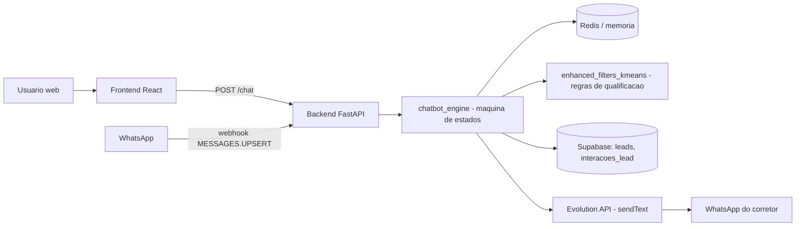

# Arquitetura do Sistema

Este documento descreve a arquitetura efetivamente identificada no código-fonte da branch `tcc-v2-final`, conforme auditoria técnica realizada em 11/10/2026.

## Visão geral dos componentes

| Componente | Tecnologia | Localização | Responsabilidade |
|---|---|---|---|
| Frontend web | React 19 + Vite | [src/](../src/) | Página institucional, formulário de busca, chat do usuário, banner de cookies |
| Backend API | FastAPI (Python 3.11) | [backend/](../backend/) | Endpoints HTTP, orquestração do chatbot, integrações |
| Motor do chatbot | Python (máquina de estados) | [backend/chatbot_engine.py](../backend/chatbot_engine.py) | Condução do diálogo, coleta de dados, montagem do relatório |
| Qualificação de leads | Python (regras heurísticas) | [backend/enhanced_filters_kmeans.py](../backend/enhanced_filters_kmeans.py) | Pontuação, classificação e recomendação por regras; suporte opcional a K-Means |
| Integração WhatsApp | Evolution API v2.3.7 | [backend/evolution_api.py](../backend/evolution_api.py) | Envio do relatório de qualificação ao corretor |
| Persistência | Supabase (PostgreSQL) | acesso em [backend/chatbot_engine.py](../backend/chatbot_engine.py) | Tabelas `leads` e `interacoes_lead` |
| Sessões | Redis (fallback em memória) | [backend/chatbot_engine.py](../backend/chatbot_engine.py) | Estado da conversa por sessão (TTL de 3600 s no Redis) |

## Fluxo de informações

1. **Canal web:** o componente [src/componentes/Chatbot.jsx](../src/componentes/Chatbot.jsx) envia a mensagem do usuário ao endpoint `POST /chat` do backend, identificado por `session_id` (timestamp gerado no navegador) e `tenant_id` (padrão `RA_IMOBILIARIA`).
2. **Canal WhatsApp:** o endpoint `POST /webhook/evolution` recebe eventos `MESSAGES.UPSERT` da Evolution API, extrai texto e remetente e aciona o mesmo motor do chatbot, usando o número do remetente como `session_id`.
3. **Motor do chatbot:** `processar_chatbot` carrega a sessão (Redis ou memória), executa a etapa corrente da máquina de estados, atualiza a sessão e retorna mensagem e opções de resposta.
4. **Qualificação:** ao final do fluxo (etapa `whatsapp`), a sessão é submetida a `qualificar_sessao_chatbot`, que calcula pontuação heurística (0–100), intenção, maturidade, prioridade comercial, justificativas e recomendação. Em paralelo, o próprio motor calcula completude, sinais positivos e pontos de atenção.
5. **Persistência:** `persistir_lead_e_interacao` normaliza o telefone, verifica se já existe lead com o mesmo número (contato recorrente) e insere/atualiza a tabela `leads`, registrando sempre um item em `interacoes_lead`.
6. **Notificação:** o relatório textual é enviado ao número do corretor pela função `enviar_mensagem_whatsapp`, via endpoint `/message/sendText/{instance}` da Evolution API.

## Separação frontend/backend

- O frontend conhece apenas o endpoint `POST /chat`; a URL do backend é definida pela variável `VITE_API_URL` e, na ausência dela, utiliza uma URL de produção fixa codificada em [src/componentes/Chatbot.jsx](../src/componentes/Chatbot.jsx).
- O frontend também possui cliente Supabase ([src/lib/supabase.js](../src/lib/supabase.js)) com chave anônima (`VITE_SUPABASE_ANON_KEY`), utilizado apenas pelo componente de diagnóstico [src/componentes/TesteSupabase.jsx](../src/componentes/TesteSupabase.jsx), que não é renderizado na página principal.
- Toda a lógica de qualificação e persistência ocorre no backend, com credenciais de serviço do Supabase (`SUPABASE_KEY`).

## Multi-inquilino (tenant)

O código prevê parametrização por `tenant_id` (variáveis `EVOLUTION_INSTANCE_<TENANT>` e `NUMERO_CORRETOR_<TENANT>`), mas a configuração efetiva contempla um único tenant: `RA_IMOBILIARIA`. O projeto não implementa provisionamento de múltiplos inquilinos.

## Componentes de implantação

- **Backend em produção (Railway):** construído pelo [Dockerfile](../Dockerfile) da raiz (imagem `python:3.11-slim`), iniciado por `python -m uvicorn backend.main:app --host 0.0.0.0 --port $PORT`, conforme [railway.toml](../railway.toml).
- **Evolution API local:** [evolution/docker-compose.yml](../evolution/docker-compose.yml) provisiona PostgreSQL 15, Redis 7 e Evolution API v2.3.7, com verificações de saúde (`healthcheck`) e volumes persistentes.
- **Frontend:** aplicação Vite; a implantação do frontend não está configurada nos arquivos auditados (não há pipeline ou configuração de hospedagem do frontend no repositório).

## Pontos de atenção arquiteturais

- O middleware CORS do backend aceita qualquer origem (`allow_origins=["*"]`), configuração permissiva própria de protótipo.
- Não há autenticação nos endpoints `/chat`, `/webhook/evolution` e `/diagnostico/evolution`.
- A função `buscar_lead_por_telefone` recupera todos os registros da tabela `leads` e filtra em memória — abordagem simples, adequada ao protótipo, mas que não escala para grandes volumes.
- O módulo [backend/database_supabase.py](../backend/database_supabase.py) existe e está implementado, porém **não é importado** pelo fluxo principal do chatbot; a persistência ocorre por funções equivalentes dentro de [backend/chatbot_engine.py](../backend/chatbot_engine.py). Trata-se de código paralelo, possivelmente remanescente de refatoração.
